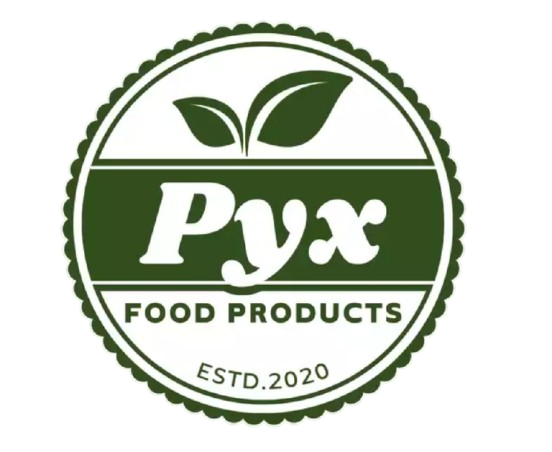
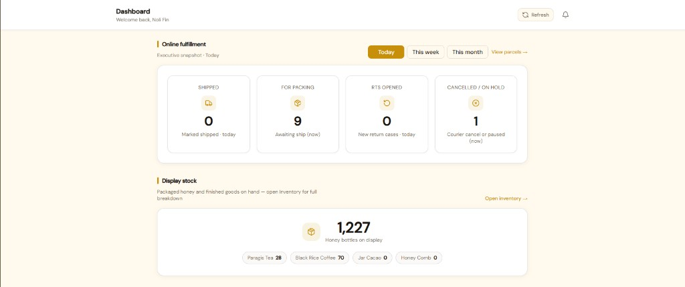
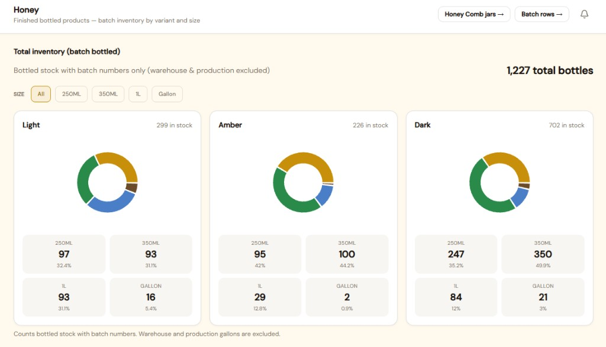
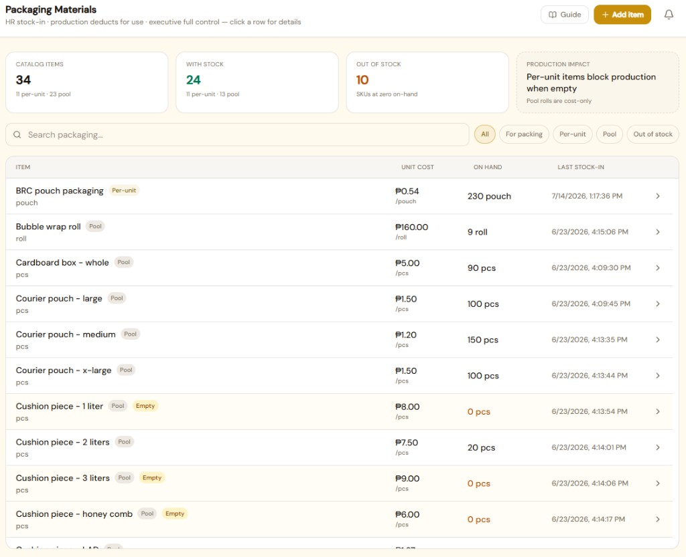
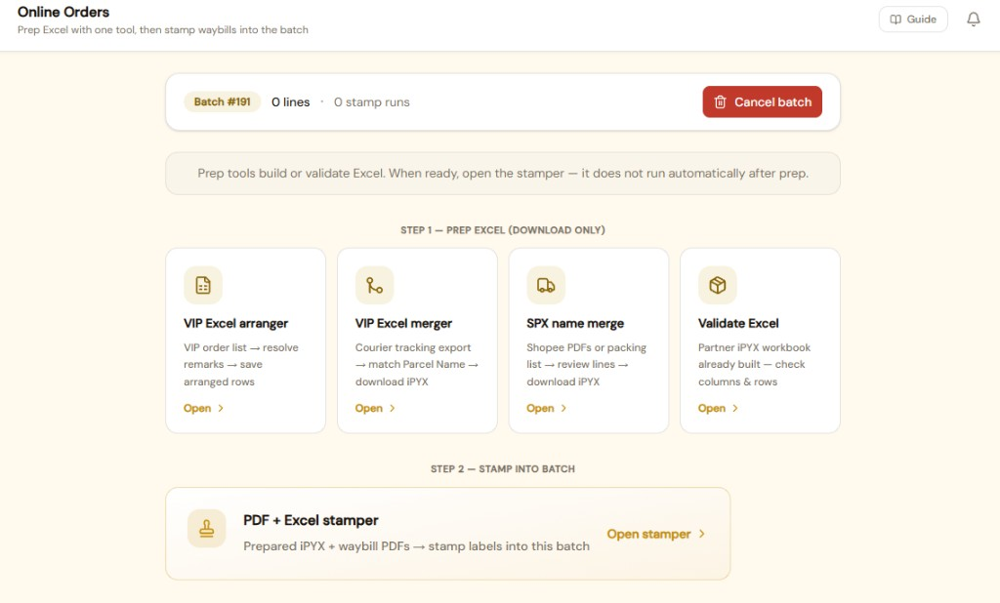
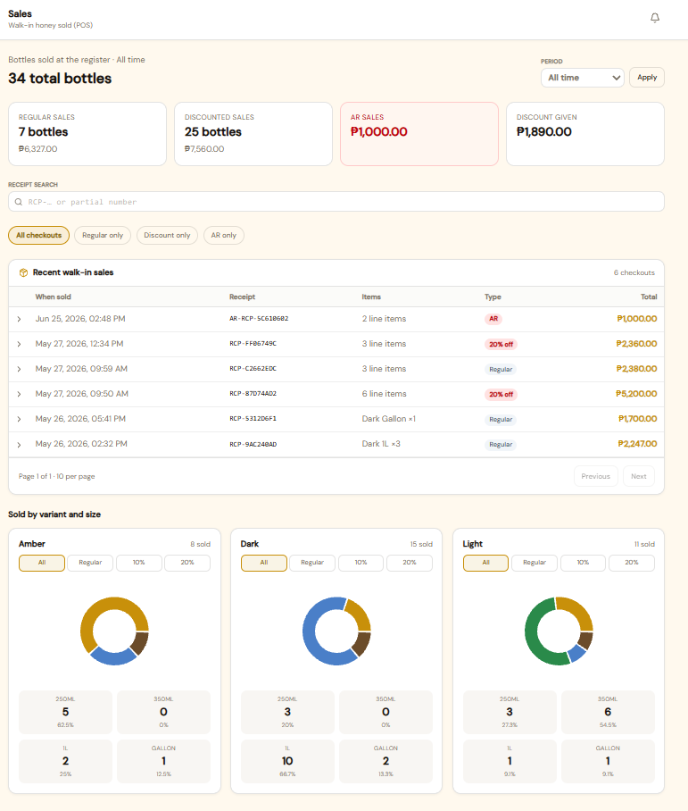
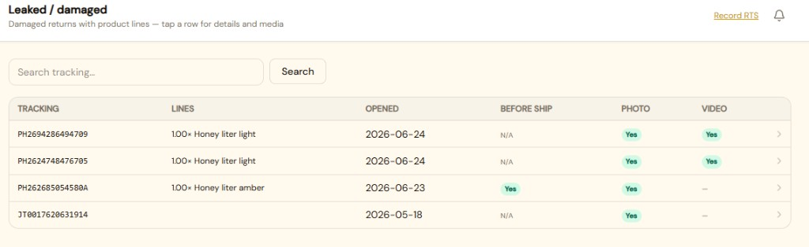

<p align="center">
  
</p>

<h1 align="center">Pyx Tracker</h1>

<p align="center">
  <strong>A web-based operations management system</strong> for multi-channel order consolidation,<br />
  inventory, production, returns (RTS), and sales — built for <a href="https://www.pyxfood.com/">Pyx Food Products</a> / Finest Wellness PH.
</p>

<p align="center">
  
  
  
  
  
  
</p>

<p align="center">
  <a href="#-features">Features</a> ·
  <a href="#-screenshots">Screenshots</a> ·
  <a href="#-tech-stack">Tech stack</a> ·
  <a href="#-quick-start">Quick start</a> ·
  <a href="#-developer">Developer</a>
</p>

---

## Overview

Pyx Tracker is an internal **operations platform** (lightweight vertical ERP) that unifies day-to-day work that used to live in spreadsheets and ad-hoc scripts:

| Domain | What it covers |
|--------|----------------|
| **Inventory & production** | Honey warehouse → production → packaging; dept products (Paragis, BRC, Jar Cacao); packaging materials & supplies |
| **Order fulfillment** | CSR Online Orders (VIP / Shopee SPX prep + PDF waybill stamper), parcels, deliveries |
| **Returns (RTS)** | Case recording, sellable & damaged pools, Use RTS / Use damaged with audit trails |
| **Sales** | Walk-in POS (PIN), AR credits, sales analytics |
| **Costing & master data** | Product COGS / parcel packaging costing, suppliers, staff & roles |

> Repo folder remains `rts/` (Apache path `/rts/`) for historical reasons — the product name is **Pyx Tracker**.

---

## Features

- **Role-based SPA** — Executive, Production Manager, HR, CSR, Team Lead / Staff, POS PIN
- **Honey pipeline** — gallons in warehouse/production, bottled stock by variant & size with batch traceability
- **Packaging materials** — per-unit vs pool SKUs, HR stock-in, production deduct, staging for packing
- **Multi-channel order consolidation** — VIP Excel tools, Shopee SPX packing-list merge, PDF + Excel waybill stamper (OCR fallback)
- **Deliveries & parcels** — scan/photo ship flow, cancel/re-waybill handling
- **RTS returns** — operational cases synced into sellable/damaged inventory; Use RTS → POS or packaging
- **POS & AR** — walk-in honey/dept sales with RTS vs non-RTS stock source; staff credit ledger
- **Product costing** — manufacturing COGS separate from fulfillment parcel packaging tiers
- **Guides & approvals** — page guides, inventory correction / supply issue request workflows

---

## Screenshots

<p align="center">
  <br />
  <em>Dashboard — fulfillment pulse and finished-goods snapshot</em>
</p>

<p align="center">
  <br />
  <em>Honey inventory — bottled stock by variant and size</em>
</p>

<p align="center">
  <br />
  <em>Packaging materials — catalog, on-hand, and production impact</em>
</p>

<p align="center">
  <br />
  <em>Online Orders — prep Excel tools + PDF/Excel waybill stamper</em>
</p>

<p align="center">
  <br />
  <em>Sales — walk-in POS volumes, discounts, and AR</em>
</p>

<p align="center">
  <br />
  <em>RTS inventory — sellable returns pool with Use RTS history</em>
</p>

---

## Tech stack

| Layer | Stack |
|-------|--------|
| **SPA** | React 18, TypeScript, Vite, Tailwind, Radix/shadcn-style UI |
| **API** | PHP 8 JSON gateway (`api/v1/*.php`), session + CSRF |
| **Database** | MySQL (`rts_system`) via PDO |
| **Heavy jobs** | Python — waybill stamper (PyMuPDF), PDF→Excel (pdfplumber), OCR (Tesseract / Poppler) |
| **Deploy (local)** | Apache (XAMPP) serving `app/dist/` + `/rts/api/v1/` |

---

## Project layout

```text
rts/
├── app/                 # React SPA (primary UI)
├── api/v1/              # JSON API endpoints
├── includes/            # Shared PHP domain logic
├── config/              # config.php, forwarding.php
├── sql/                 # Migrations
├── waybill-stamper/     # Python stamp engine
├── pdf-to-excel/        # PDF label extraction
├── docs/readme/         # README images
├── tools/               # verify.ps1, memory-bank generators
└── _System_Core/        # Specs, plans, architecture notes
```

---

## Quick start

### Prerequisites

- PHP 8 + Apache (XAMPP) + MySQL  
- Node.js 18+ (SPA)  
- Python 3 + packages for waybill/OCR tools (optional until you use CSR stampers)

### 1. Database

1. Create database `rts_system` (or the name in `config/config.php`).
2. Run SQL migrations under `sql/` in order (`migration_phase*.sql`).
3. Apply newer phases as needed (e.g. `migration_phase53_rts_pool_use_log.sql`).

### 2. Config

```bash
cp config/config.sample.php config/config.php
# optional ngrok / HTTPS camera forwarding:
cp config/forwarding.sample.php config/forwarding.php
```

Prefer an **external** `storage.root` so uploads are not inside the git tree.

### 3. SPA

```bash
cd app
npm install
npm run dev          # http://localhost:5173 — proxies /rts/api
npm run build:prod   # → app/dist/ for Apache
```

**Production URL (local):** `http://localhost/rts/app/dist/`  
**API base:** `/rts/api/v1/`

### 4. Verify (dev / agents)

```powershell
powershell -File tools/verify.ps1
powershell -File tools/verify.ps1 -WithApi   # when XAMPP is up
```

<details>
<summary><strong>Waybill / OCR setup (Windows)</strong></summary>

Required only for Online Orders stamper, PDF→Excel, and OCR fallbacks.

1. Install Python 3 (add to PATH).
2. `pip install pdfplumber openpyxl PyMuPDF pytesseract pdf2image`
3. Install [Tesseract OCR](https://github.com/UB-Mannheim/tesseract/wiki) and [Poppler](https://github.com/oschwartz10612/poppler-windows/releases).
4. In `php.ini`, ensure `shell_exec` is allowed; raise upload limits for large PDFs.
5. Optional: copy `waybill-stamper/paths.sample.json` → `paths.json` for custom Tesseract/Poppler paths.

See [`waybill-stamper/SETUP.md`](waybill-stamper/SETUP.md) and [`pdf-to-excel/README.md`](pdf-to-excel/README.md).

</details>

---

## Roles (SPA)

| Role | Typical access |
|------|----------------|
| `executive` | Full inventory, costing, suppliers, RTS, waybill, staff, settings |
| `prod_manager` | Honey ops, packaging deduct, RTS, deliveries, reports |
| `hr` | Packaging/supplies stock-in, requests; read-heavy inventory |
| `csr_tl` / `csr_staff` | Online Orders, RTS recording |
| `team_leader` / `staff` | Dept stock tools |
| `pos` | POS terminal only |

---

## Documentation

| Doc | Purpose |
|-----|---------|
| [`_System_Core/000_System_Architecture.md`](_System_Core/000_System_Architecture.md) | Architecture & rules |
| [`_System_Core/010_Product_Theory.md`](_System_Core/010_Product_Theory.md) | Product theory |
| [`_System_Core/001_System_State.md`](_System_Core/001_System_State.md) | Active spec / sprint |
| [`docs/Pyx_Tracker_Executive_Guide.docx`](docs/Pyx_Tracker_Executive_Guide.docx) | Non-technical overview |
| [`app/README.md`](app/README.md) | SPA commands |

---

## Developer

<p align="center">
  
  &nbsp;&nbsp;
  
</p>

<p align="center">
  <strong>Noli M Fin III</strong><br />
  Full-stack developer · Pyx Tracker<br />
  <a href="https://www.linkedin.com/in/noli-fin-5b295a276/">LinkedIn</a>
  ·
  <a href="https://www.pyxfood.com/">Pyx Food Products</a>
</p>

Built as an internal operations system for Finest Wellness PH / Pyx Food Products (Polomolok, South Cotabato).

---

## License / use

Internal tooling for Finest Wellness PH / Pyx Food Products.  
Do **not** commit secrets (`config/config.php`, credentials, `.env`) to git.
