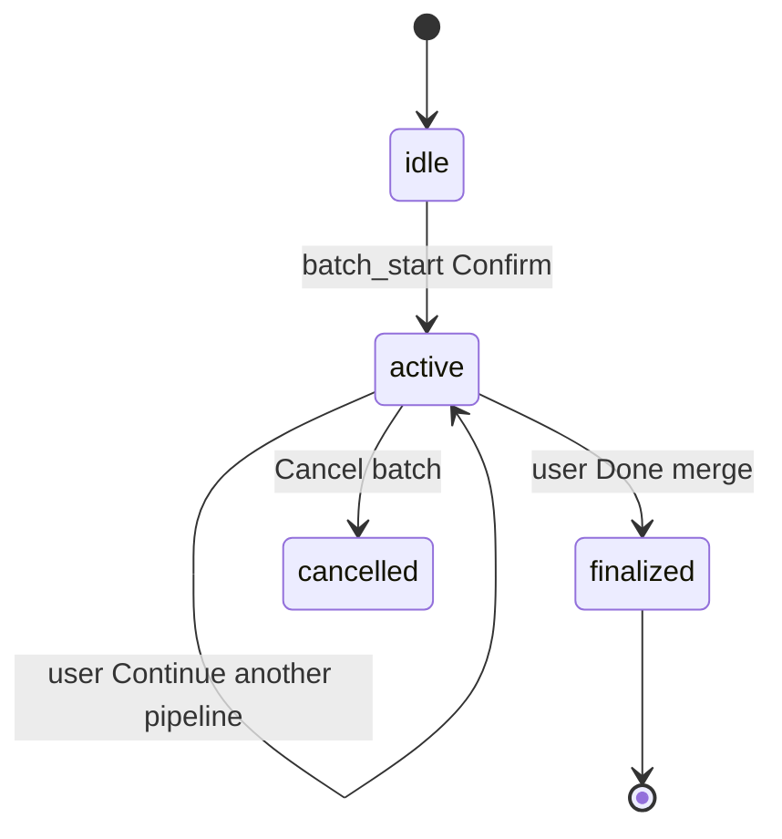

# Implementation Plan: Online Orders Generator

> **AI drafts this** from a spec. Human approves before any code.  
> Spec: [[specs/2026-06-04_Online-Orders-Generator]]

## Summary

Unify the three CSR waybill tools (Stamper, PDF→Excel, Order Remarks) into one **batch-oriented wizard** at `/waybill/online-orders`. Users start a batch, run one or more pipelines (partner sellers / VIP / Shopee SPX), then **finalize** into a single master iPYX-style Excel (cols B–H: Order No., Name, Item/s, Note blank, spacer blank, Courier, Tracking) and **persist order lines** (tracking + items) for future inventory integration. Existing Python/PHP engines (`waybill-stamper/processor.py`, `pdf-to-excel/extractor.py`, `order_remarks_workbook.py`) are **reused**, not rewritten. A thin orchestration layer (`includes/online_orders_generator.php` + `api/v1/online_orders.php`) owns batch state, row accumulation, merge export, and DB writes.

## Constraints (must read)

- [[000_System_Architecture]] — `api/v1` + `api_dispatch`, CSRF, role guards
- [[003_Fragile_Edges]] — reuse `waybill_stamper_user_can_access()` for auth (do not fork access logic); no new `includes/` → `api/v1/` reverse includes
- UI: [[004_SPA_Design_System]] · [[005_SPA_UX_Patterns]] — `PageLayout`, `OrderRemarksToast`, `AmbiguousOrderCarousel` / `orderRemarksMotion`, avoid new one-off modal styles
- Product: [[010_Product_Theory]] principle #3 — PDF→Excel→Stamper chain stays compatible; iPYX template unchanged
- **Out of scope (spec):** inventory deduct from saved lines — store data only

## Recommended process improvements (answers open question in spec)

| Idea | Recommendation |
|------|----------------|
| Single entry point | Replace sidebar “Waybill” sub-menu with one **Online Orders** link; redirect old routes to hub |
| Server-side batch | Persist batch + lines in DB (not only React state) so refresh/crash does not lose work |
| Shared “item resolver” UI | Reuse `AmbiguousOrderCarousel` pattern for **Shopee SPX** line items (PDF extract gives name/TN/courier only) |
| Pipeline picker after batch confirm | Explicit three cards (partner / VIP / Shopee SPX) — matches mental model, reduces wrong-tool confusion |
| Continue vs Done | After each run, append normalized rows to batch; **Done** triggers merge + download + `processed` flag |
| Future (v2) | Auto-detect pipeline from uploaded file types; optional inventory deduct hook on `csr_online_order_lines` |

---

## Impact preview

| Area | Change |
|------|--------|
| **API** | New `api/v1/online_orders.php` (batch lifecycle + row append + finalize). Existing `waybill.php`, `pdf_to_excel.php`, `order_remarks.php` **called internally or from SPA** with `batch_id` context — minimal changes to add optional `batch_id` + normalized row callback |
| **Includes** | New `includes/online_orders_generator.php`. Touch `waybill_stamper.php`, `pdf_to_excel.php`, `order_remarks.php` only for shared helpers / row normalization (no reverse includes to `_bootstrap`) |
| **DB** | New tables: `csr_online_batches`, `csr_online_batch_runs`, `csr_online_order_lines` (+ migration SQL) |
| **SPA** | New `OnlineOrdersGeneratorPage.tsx`, wizard components, `onlineOrdersApi.ts`. Update `Sidebar.tsx`, `routes.ts`. Redirects from `/waybill/stamper`, `/waybill/pdf-to-excel`, `/waybill/order-remarks` |
| **Python** | No template changes required v1; optional: export normalized rows from extract JSON (already has tracking/name/items/courier) |
| **Roles** | Extend access to **`csr_staff`** (spec) via shared `waybill_stamper_user_can_access()` extension or parallel check in `online_orders_*` |

_Run `impact.php` before editing: `waybill_stamper_user_can_access`, `waybill_stamper_process_uploads`, `pdf_to_excel_extract`, `order_remarks_export_workbook`._

---

## Domain model

### Pipeline types

| ID | Spec step | Existing engines | Normalized output per parcel |
|----|-----------|------------------|----------------------------|
| `partner` | §4 — PDF + worker Excel | `waybill.php` stash/process | Rows from stamped Excel match keys (TN → name, items, courier) |
| `vip` | §5 — remarks Excel → export → PDF stamp | `order_remarks.php` + `waybill.php` | VIP export rows + stamped waybill metadata |
| `shopee_spx` | §6 — PDF → extract → resolve items → stamp | `pdf_to_excel.php` + item resolver UI + `waybill.php` | After user resolves items per TN |

### Master print Excel (finalize)

Match iPYX layout used by stamper / PDF extractor ([`pdf-to-excel/extractor.py`](pdf-to-excel/extractor.py) cols B–H):

- **B** Order No. (blank if unknown)
- **C** Name
- **D** Item/s (exact honey variants after resolution)
- **E** Note — leave blank per spec
- **F** blank
- **G** Courier
- **H** Tracking Number

Implementation: PhpSpreadsheet writer in `online_orders_generator_merge_workbook()` (Composer already has `phpoffice/phpspreadsheet`).

### Batch state machine

---

## API design (`api/v1/online_orders.php`)

All actions: `api_dispatch`, `ims_current_user()`, CSRF on POST, access same as waybill (`executive`, `csr_tl`, **`csr_staff`**).

| Action | Method | Purpose |
|--------|--------|---------|
| `batch_start` | POST | Create batch (`status=active`), return `batch_id` |
| `batch_get` | GET | Current batch for user (active only) + runs + line count |
| `batch_cancel` | POST | Cancel active batch |
| `run_partner` | POST | Body: `{ batch_id, pdf_tokens[], excel_tokens[] }` — delegates to waybill process; extracts matched rows into `csr_online_order_lines` |
| `run_vip_remarks_parse` | GET | `token`, `batch_id` — wrap order_remarks parse |
| `run_vip_remarks_export` | POST | `{ batch_id, token, remarks[] }` — export + stash VIP excel path on run |
| `run_vip_stamp` | POST | `{ batch_id, pdf_tokens[], excel_token }` — waybill process using VIP excel |
| `run_shopee_extract` | POST | `{ batch_id, pdf_tokens[] }` — pdf_to_excel extract; return rows needing item resolution |
| `run_shopee_resolve` | POST | `{ batch_id, job_token, rows: [{ page, tracking, items }] }` — save resolved items; build temp excel for stamper |
| `run_shopee_stamp` | POST | `{ batch_id, pdf_tokens[], excel_token }` — waybill process |
| `batch_finalize` | POST | `{ batch_id }` — merge all lines → master xlsx, `status=processed`, download token |
| `batch_download` | GET | `token` — serve merged file (same pattern as waybill download) |

**v1 alternative (lower backend risk):** SPA calls existing `waybill.php` / `pdf_to_excel.php` / `order_remarks.php` directly; only new endpoints are `batch_*`, `lines_append` (POST normalized rows JSON), `batch_finalize`. Prefer **delegation wrappers** in `online_orders.php` so row extraction stays server-authoritative.

---

## Database (new migration)

**File:** `sql/migration_phase17_csr_online_orders.sql`

### `csr_online_batches`

| Column | Type | Notes |
|--------|------|-------|
| `id` | INT PK AI | |
| `user_id` | INT UNSIGNED | FK → `users.id` |
| `status` | ENUM(`active`,`processed`,`cancelled`) | |
| `created_at` | DATETIME | |
| `completed_at` | DATETIME NULL | |
| `master_file_token` | VARCHAR(64) NULL | download token after finalize |
| `master_filename` | VARCHAR(255) NULL | |

### `csr_online_batch_runs`

| Column | Type | Notes |
|--------|------|-------|
| `id` | INT PK AI | |
| `batch_id` | INT | FK |
| `pipeline` | ENUM(`partner`,`vip`,`shopee_spx`) | |
| `status` | ENUM(`started`,`completed`,`failed`) | |
| `meta_json` | JSON NULL | tokens, filenames, counts |
| `created_at` | DATETIME | |

### `csr_online_order_lines`

| Column | Type | Notes |
|--------|------|-------|
| `id` | INT PK AI | |
| `batch_id` | INT | FK |
| `run_id` | INT NULL | FK |
| `order_no` | VARCHAR(64) NULL | |
| `recipient_name` | VARCHAR(255) | |
| `items` | TEXT | exact variant string |
| `courier` | VARCHAR(64) | |
| `tracking_number` | VARCHAR(96) | indexed |
| `source_pipeline` | ENUM(...) | |
| `created_at` | DATETIME | |

Index: `(batch_id)`, `(tracking_number)` for future inventory lookup.

---

## SPA design

### Route & nav

| Item | Value |
|------|-------|
| **Route** | `/waybill/online-orders` |
| **Component** | `OnlineOrdersGeneratorPage.tsx` |
| **Roles** | `executive`, `csr_tl`, **`csr_staff`** (align with spec) |
| **Sidebar** | Replace `waybillGroup` children with single link **Online Orders** → `/waybill/online-orders` |
| **Redirects** | `/waybill/stamper` → `/waybill/online-orders?legacy=stamper` (optional deep link) or simple `Navigate` replace |

### Wizard steps (UI)

1. **Start modal** — “Create new batch?” Confirm / Cancel (`ui/alert-dialog` or `POSModal` pattern per [[005_SPA_UX_Patterns]])
2. **Pipeline picker** — three cards: Partner sellers | VIP | Shopee SPX (ours)
3. **Pipeline sub-flow** (embedded step components):
   - `PartnerRunStep` — extract from `WaybillStamperPage` (PDF + Excel zones → `stampWaybillsFromFiles`)
   - `VipRunStep` — Order remarks parse/carousel/export download → prompt PDF upload → stamp
   - `ShopeeSpxRunStep` — PDF upload → extract → **ItemResolverCarousel** (clone `AmbiguousOrderCarousel` UX for items, not remarks) → stamp
4. **Post-run** — “Process another?” Continue (back to picker) / Done
5. **Finalize** — loading → master Excel download + success toast (`OrderRemarksToast`)

### New / refactored frontend files

| File | Action |
|------|--------|
| `app/src/app/pages/csr/OnlineOrdersGeneratorPage.tsx` | create — wizard shell + state |
| `app/src/app/components/csr/onlineOrders/BatchStartModal.tsx` | create |
| `app/src/app/components/csr/onlineOrders/PipelinePicker.tsx` | create |
| `app/src/app/components/csr/onlineOrders/PartnerRunStep.tsx` | create (wrap waybill UI) |
| `app/src/app/components/csr/onlineOrders/VipRunStep.tsx` | create (wrap order remarks + waybill) |
| `app/src/app/components/csr/onlineOrders/ShopeeSpxRunStep.tsx` | create |
| `app/src/app/components/csr/onlineOrders/ItemResolverCarousel.tsx` | create — based on `AmbiguousOrderCarousel` |
| `app/src/app/lib/onlineOrdersApi.ts` | create |
| `app/src/app/lib/onlineOrdersTypes.ts` | create — batch, run, line types |
| `app/src/app/components/Sidebar.tsx` | modify — nav group |
| `app/src/app/routes.ts` | modify — route + redirects |
| `app/src/app/pages/csr/WaybillStamperPage.tsx` | keep temporarily or thin redirect wrapper |

Reuse: `orderRemarksMotion.tsx`, `orderRemarksParse.ts`, `waybillApi.ts`, `pdfToExcelApi.ts`, `orderRemarksApi.ts`.

---

## Implementation steps

### Phase 1 — Data / backend foundation

1. [ ] Add `sql/migration_phase17_csr_online_orders.sql` (three tables + indexes)
2. [ ] Create `includes/online_orders_generator.php`:
   - `online_orders_user_can_access()` — extend waybill access for `csr_staff` if product approves
   - `online_orders_batch_start/get/cancel/finalize`
   - `online_orders_lines_append()` — normalize + INSERT
   - `online_orders_merge_master_workbook()` — PhpSpreadsheet iPYX layout
   - Row parsers: from waybill process result log / excel parse / pdf extract JSON / VIP export
3. [ ] Storage: `storage/online-orders/{batches,outputs}` for merged files

### Phase 2 — API

1. [ ] Create `api/v1/online_orders.php` with actions table above
2. [ ] Add helper to extract rows after internal waybill process (parse processor log or re-read excel — **spike in Phase 1**: confirm best row source from `waybill_stamper_process_uploads` return payload)
3. [ ] Wire VIP + Shopee paths to call existing includes functions (require modules, not HTTP loopback)
4. [ ] Download action mirroring `waybill_stamper_serve_download` pattern

### Phase 3 — Frontend wizard

1. [ ] `onlineOrdersApi.ts` + types
2. [ ] `OnlineOrdersGeneratorPage` state machine (`batchId`, `step`, `runsCompleted`)
3. [ ] Implement sub-steps by composing existing page logic (extract shared hooks from Waybill/OrderRemarks/PdfToExcel pages to avoid duplication)
4. [ ] `ItemResolverCarousel` for Shopee SPX item lines
5. [ ] Sidebar + routes + redirects
6. [ ] Toasts on confirm/complete per [[005_SPA_UX_Patterns]]

### Phase 4 — Integration, docs, cleanup

1. [ ] Manual E2E per pipeline + multi-pipeline batch finalize
2. [ ] Update `README.md` CSR section (single Online Orders flow)
3. [ ] Regenerate memory bank; append [[002_Memory_Bank]]
4. [ ] Update [[001_System_State]] — clear active spec/plan or mark done
5. [ ] Move this plan to `plans/archive/`
6. [ ] Optional deprecation banner on old standalone pages for one release

---

## Files to touch (expected)

| File | Action |
|------|--------|
| `sql/migration_phase17_csr_online_orders.sql` | create |
| `includes/online_orders_generator.php` | create |
| `api/v1/online_orders.php` | create |
| `includes/waybill_stamper.php` | modify — optional: return structured matched rows for batch append |
| `includes/pdf_to_excel.php` | modify — optional: accept resolved items → write stamper-ready excel |
| `includes/order_remarks.php` | modify — minimal — VIP row export hook |
| `app/src/app/pages/csr/OnlineOrdersGeneratorPage.tsx` | create |
| `app/src/app/components/csr/onlineOrders/*.tsx` | create (6–7 files) |
| `app/src/app/lib/onlineOrdersApi.ts` | create |
| `app/src/app/components/Sidebar.tsx` | modify |
| `app/src/app/routes.ts` | modify |
| `app/src/app/pages/csr/WaybillStamperPage.tsx` | modify — redirect or extract hook |
| `app/src/app/pages/csr/PdfToExcelPage.tsx` | modify — redirect or extract hook |
| `app/src/app/pages/csr/OrderRemarksPage.tsx` | modify — redirect or extract hook |
| `README.md` | modify — CSR workflow docs |

**Do not edit:** `waybill-stamper/processor.py` template matching logic (unless row extraction spike requires log format change only).

---

## Test plan

### Access

- [ ] `csr_tl` can open `/waybill/online-orders`, start batch, cancel
- [ ] `executive` same
- [ ] **`csr_staff`** can access if approved in Phase 1 access helper
- [ ] `prod_manager` forbidden (403 / Forbidden screen)

### Pipeline: Partner sellers

- [ ] Upload worker PDF + iPYX Excel → stamp succeeds (matched count > 0)
- [ ] Continue → picker shows again; second partner run appends lines
- [ ] Done → master Excel columns B–H correct; E/F blank; download works
- [ ] DB: `csr_online_order_lines` has tracking + items per row; batch `status=processed`

### Pipeline: VIP

- [ ] Upload VIP courier Excel → ambiguous carousel appears when needed
- [ ] Export remarks Excel → user downloads → upload VIP waybill PDF → stamp
- [ ] Lines appear in batch; finalize includes VIP rows

### Pipeline: Shopee SPX

- [ ] PDF-only upload → extract shows rows with missing items
- [ ] Item resolver carousel (same UX as order remarks) → all rows complete
- [ ] Generated excel compatible with stamper → stamped PDF downloads
- [ ] Finalize merges with prior partner/VIP rows in same batch

### Regression

- [ ] Existing `api/v1/waybill.php?action=process` still works if old URL bookmarked (until redirect)
- [ ] CSRF failures return 419
- [ ] Large PDF per-file 60MB guard still enforced

### Memory bank

- [ ] `php tools/memory_bank/generate_all.php` after merge
- [ ] `impact.php` on any modified `includes/` function

---

## Risks & mitigations

| Risk | Mitigation |
|------|------------|
| Waybill process does not return structured row data for DB | Spike: parse excel after stamp or extend processor JSON output; don’t guess from log excerpt only |
| Duplicating 3 large pages → drift | Extract shared hooks (`useWaybillStamp`, `useOrderRemarksFlow`, `usePdfToExcelFlow`) in Phase 3 |
| `waybill_stamper_user_can_access` excludes `csr_staff` | Explicit product sign-off; extend in one function used by all CSR tools |
| Session stash tokens expire mid-batch | Document 1h TTL; batch_finalize prompt if token expired; server-side copy excel to batch storage on each run |
| VIP flow needs user to download then re-upload excel | Keep explicit UI instructions + file picker step (spec §5) |
| Shopee “Color Mix” → exact variants | Reuse `orderRemarksParse` / honey variant labels where possible; shared variant picker component |
| Fragile edge: pdf/order_remarks piggyback waybill access | New module calls same `waybill_stamper_user_can_access()` — no new access fork |
| Master merge column mismatch with packers’ expectation | Use same constants as `extractor.py` HEADER_ROW / col indices; visual diff against known good iPYX file |

---

## Rollback

1. Revert migration: drop three tables (dev only) or leave tables unused
2. Restore Sidebar three links + old routes
3. Remove `online_orders.php` endpoint
4. Old standalone pages unchanged if not deleted

Feature flag optional: `config` key `online_orders_generator_enabled` default true after QA.

---

## Open decisions (human approval before implement)

1. **`csr_staff` access** — spec says “sometimes CSR staff”; confirm role addition to waybill/online-orders access.
2. **Keep legacy URLs** — redirect only vs keep sidebar sub-links for one release.
3. **Row extraction source** — prefer extending waybill API response vs re-parsing excel (Phase 1 spike).
4. **Note column (E)** — spec says blank; extractor uses “Note” — confirm packers want always empty on master sheet.

---

## Approval

- [ ] Human approved — OK to implement in Agent mode
- [ ] Open decisions above resolved
- Approved date: _
