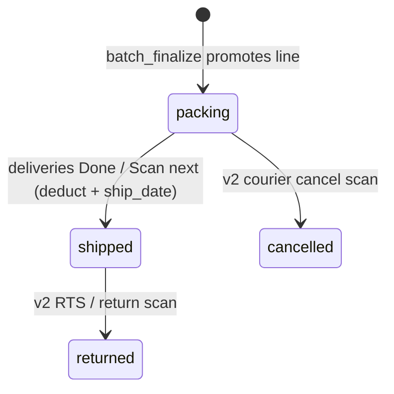

# Implementation Plan: Inventory Connection to Everything

> **AI drafts this** from a spec. Human approves before any code.  
> Spec: [[specs/Inventory Connection to Everything]]

## Summary

Close the loop between **CSR online order batches** (already persisted in `csr_online_order_lines` on finalize) and **production shipping**: when CSR finalizes a master Excel, promote each line with a tracking number into an **`online_order_parcels`** registry (`status=packing`, `ship_date`/`return_date` null). Migrate **pre-dispatch deliveries** (photo + QR scan) from legacy `deliveries/*.php` + `api/delivery_*.php` into the React SPA for **executive** and **prod_manager** only, showing parcel **Item/s** on scan and setting **`ship_date`** when the manager finishes a parcel. On **Done** or **Scan next parcel**, run **aggregate honey packaging deduct** (FIFO by `bottling_date`, same pattern as POS — no packer-facing batch pick) using a shared **item-line parser** that understands LAD combos, `1 LITER Amber`, Shopee shorthand, etc. Add a **parcel lookup** SPA tab (search TN or scan QR) for executive, CSR TL, and prod manager. **Courier cancel / inventory restore** and **full POS paper replacement** stay out of v1 per spec.

Builds on shipped Online Orders Generator ([[plans/archive/2026-06-04_Online-Orders-Generator_plan]]).

## Constraints (must read)

- [[000_System_Architecture]] — new work in `api/v1/*` + `includes/*` + SPA; `api_dispatch`, CSRF, IMS session
- [[003_Fragile_Edges]] — **dual auth**: legacy deliveries use `rts_auth_user()` / `app_users`; SPA must use `ims_current_user()` / `users` — plan an IMS-first `api/v1/deliveries.php` without breaking RTS `delivery_match_tracking.php` until bridged
- **Honey deduct** — reuse `honey_pos_deduct_packaging_aggregate()` pattern ([[modules/honey_pos#honey_pos_deduct_packaging_aggregate]]); do not add `includes/` → `api/v1/` reverse includes; avoid new top-level `honey_inventory.php` ↔ `honey_pricing.php` requires
- **Item strings** — align parser with `app/src/app/lib/orderRemarksParse.ts`, `honeyItemVariant.ts`, and `pdf-to-excel/extractor.py` rules ([[003_Fragile_Edges#Shopee / marketplace PDF item lines]])
- **Tracking normalize** — reuse `rts_normalize_tracking_from_qr()` from `includes/qr_decode.php` for scan/search parity with deliveries + RTS
- UI: [[004_SPA_Design_System]] · [[005_SPA_UX_Patterns]] — `PageLayout`, scanner modal pattern from legacy deliveries, `OrderRemarksToast` / success overlays
- Product: [[010_Product_Theory]] — single source for inventory truth; corrections via approval, not silent deduct undo (cancel-restore is v2)

## Recommended phasing (dependency order)

| Phase | Delivers | Depends on |
|-------|----------|------------|
| **A** | Parcels table + promote on `batch_finalize` + parser + deduct service | Online Orders lines exist |
| **B** | Deliveries SPA + `api/v1/deliveries.php` (photo upload, scan flow, ship + deduct) | Phase A |
| **C** | Parcel registry / lookup UI | Phase A |
| **D (v2)** | Cancelled parcel scan → restock; POS parcel link; packaging UI “daily total only” | Stakeholder sign-off |

---

## Impact preview

| Area | Change |
|------|--------|
| **API** | New `api/v1/parcels.php` (lookup, list, parse preview); new `api/v1/deliveries.php` (bulk photo, batch status, ship+deduct); extend `api/v1/online_orders.php` (`batch_finalize` side effect); optional thin proxy or shared includes for legacy `api/delivery_match_tracking.php` consumers |
| **Includes** | New `includes/online_order_parcels.php`, `includes/honey_parcel_item_parser.php`, `includes/honey_parcel_inventory.php`; touch `online_orders_generator.php`, `qr_decode.php` (reuse only), `honey_pos.php` or extract shared aggregate helper |
| **DB** | New `online_order_parcels`, `online_parcel_deduct_lines` (audit); optional `honey_sales_log.online_parcel_id`; optional `delivery_batch_items.online_parcel_id` link column |
| **SPA** | `DeliveriesPage`, `DeliveriesReviewPage`, `OnlineParcelsPage`; `deliveriesApi.ts`, `parcelsApi.ts`; `routes.ts`, `Sidebar.tsx`; login redirect for prod_manager/executive |
| **Legacy** | `deliveries/index.php`, `deliveries/review.php` → redirect or deprecation banner to SPA |
| **Python** | No change v1 (parser parity documented; optional later: export normalized deduct JSON from extractor) |

_Run before edit:_ `php tools/memory_bank/impact.php online_orders_batch_finalize`, `honey_pos_deduct_packaging_aggregate`, `rts_normalize_tracking_from_qr`.

---

## Domain model

### Parcel lifecycle



| Status | Meaning |
|--------|---------|
| `packing` | In CSR master sheet / awaiting prod scan |
| `shipped` | Photo captured, `ship_date` set, inventory deducted |
| `cancelled` | v2 — courier cancelled at pickup |
| `returned` | v2 — RTS return (optional link) |

### Item parsing → deduct lines

Parser output (internal):

```json
[
  { "variant": "light", "size": "liter", "qty": 1 },
  { "variant": "amber", "size": "liter", "qty": 1 },
  { "variant": "dark", "size": "liter", "qty": 1 },
  { "variant": "amber", "size": "350ml", "qty": 1 }
]
```

**Examples (spec):**

| Item/s string | Deduct interpretation |
|---------------|----------------------|
| `1 x 3L Honey (LAD) + 350ml (A)` | 1×1L light + 1×1L amber + 1×1L dark + 1×350ml amber |
| `1 LITER Amber` | 1× liter amber |
| `1 x 1L HONEY w/SF` (unresolved) | Block ship/deduct; force CSR resolution before finalize (existing Shopee carousel) |

**Implementation note:** Port rules from `orderRemarksParse.ts` (`LAD`, `VALID_3L`, `buildFinalRemark`) and `extractor.py` / `honeyItemVariant.ts` into PHP `honey_parcel_item_parser.php`. Expose `parse_items_string(string): array{deltas, errors}` for API preview and pre-ship validation.

### Inventory deduct rules

- Use **aggregate FIFO** across `honey_packaging_rows` (same as POS checkout) — **no** packer selection of `batch_no`
- Log each ship event: `honey_sales_log` with `sale_type=parcel`, `source=packaging`, optional `online_parcel_id`
- Persist audit rows in `online_parcel_deduct_lines` (variant, size, qty, packaging_row_id, parcel_id)
- **Idempotency:** if parcel already `shipped`, second scan must not double-deduct (return 409 with parcel summary)
- **Insufficient stock:** fail transaction with clear variant/size message (mirror POS errors)

### Relationship to existing tables

| Existing | Role in this feature |
|----------|---------------------|
| `csr_online_order_lines` | Source rows at finalize; keep for batch history |
| `csr_online_batches` | `processed` triggers parcel promotion |
| `delivery_batches` / `delivery_batch_items` | Pre-dispatch **photos** (unchanged purpose); link `online_parcel_id` when TN matches |
| `honey_packaging_rows` | Stock decremented via aggregate deduct |
| `honey_sales_log` | Audit trail per ship |

---

## API design

### `api/v1/online_orders.php` (extend)

| Action | Change |
|--------|--------|
| `batch_finalize` | After merge + `status=processed`, call `online_parcels_promote_from_batch($pdo, $batchId)` |

No new public action required for CSR beyond existing finalize UX.

### `api/v1/parcels.php` (new)

| Action | Method | Roles | Purpose |
|--------|--------|-------|---------|
| `list` | GET | executive, prod_manager, csr_tl | Paginated table: tracking, items, status, ship_date, courier, batch_id |
| `get` | GET | + csr_staff? **no** — spec: executive, CSR TL, prod manager only | By `tracking` or `id` |
| `lookup` | GET | same | Normalize TN/QR blob → single parcel card |
| `parse_preview` | POST | prod_manager, executive (debug) | Body `{ items }` → parsed deltas + errors (support tool) |

All: `ims_current_user()`, CSRF on POST.

### `api/v1/deliveries.php` (new — IMS)

| Action | Method | Roles | Purpose |
|--------|--------|-------|---------|
| `batch_for_date` | GET | executive, prod_manager | Today’s `delivery_batches` row + item count |
| `upload_photo` | POST | executive, prod_manager | Multipart: `delivery_date`, `photo`, `tracking`, `client_hint` — mirrors `api/delivery_bulk.php` logic via shared include |
| `parcel_by_tracking` | GET | executive, prod_manager | Join `online_order_parcels` + optional today’s `delivery_batch_items` |
| `ship_parcel` | POST | executive, prod_manager | Body `{ tracking_number, delivery_item_id? }` — set `ship_date`, status `shipped`, run deduct; idempotent |

**Auth migration:** Map `submitted_by_user_id` to `users.id` (IMS) for new batches; keep reading legacy batches with `app_users` id where needed (probe / dual-write one release).

### Legacy APIs (keep during transition)

| Path | Status |
|------|--------|
| `api/delivery_bulk.php` | Deprecate after SPA ships; RTS record flow may still call `delivery_match_tracking.php` |
| `api/delivery_match_tracking.php` | Keep for `record.php` damaged gate until RTS SPA uses v1 wrapper |
| `api/delivery_batch_detail.php`, `api/delivery_resolve.php` | Port review/resolve into SPA actions or call from v1 |

---

## Database (new migration)

**File:** `sql/migration_phase18_online_order_parcels.sql`

### `online_order_parcels`

| Column | Type | Notes |
|--------|------|-------|
| `id` | INT PK AI | |
| `csr_batch_id` | INT UNSIGNED NULL | FK → `csr_online_batches.id` |
| `csr_line_id` | INT UNSIGNED NULL | FK → `csr_online_order_lines.id` |
| `tracking_number` | VARCHAR(96) NOT NULL | UNIQUE (confirm with ops — re-ship policy) |
| `items_raw` | TEXT NOT NULL | Exact Item/s string |
| `items_parsed_json` | JSON NULL | Cached parser output |
| `recipient_name` | VARCHAR(255) | From line |
| `courier` | VARCHAR(64) | |
| `order_no` | VARCHAR(64) NULL | |
| `source_pipeline` | ENUM(`partner`,`vip`,`shopee_spx`) | |
| `status` | ENUM(`packing`,`shipped`,`cancelled`,`returned`) | Default `packing` |
| `ship_date` | DATE NULL | Set on prod ship |
| `return_date` | DATE NULL | v2 |
| `shipped_by_user_id` | INT UNSIGNED NULL | FK → `users.id` |
| `deducted_at` | DATETIME NULL | |
| `created_at` | DATETIME | |

Indexes: `(tracking_number)`, `(status)`, `(csr_batch_id)`, `(ship_date)`.

### `online_parcel_deduct_lines`

| Column | Type | Notes |
|--------|------|-------|
| `id` | INT PK AI | |
| `parcel_id` | INT | FK |
| `packaging_row_id` | INT UNSIGNED | Row touched in FIFO |
| `variant` | VARCHAR(32) | |
| `size` | ENUM mapping to liter/250ml/350ml/gallon | |
| `qty` | DECIMAL | |

### Optional alterations

- `honey_sales_log.online_parcel_id` INT UNSIGNED NULL + FK
- `delivery_batch_items.online_parcel_id` INT UNSIGNED NULL (link photo row to parcel)

---

## SPA design

### Routes & nav

| Path | Component | Roles |
|------|-----------|-------|
| `/deliveries` | `DeliveriesPage` | executive, prod_manager |
| `/deliveries/review` | `DeliveriesReviewPage` | executive, prod_manager |
| `/fulfillment/online-parcels` | `OnlineParcelsPage` | executive, prod_manager, csr_tl |

| Nav | Change |
|-----|--------|
| Sidebar | **Deliveries** group (prod_manager + executive); **Online parcels** under Waybill or Fulfillment for CSR TL + exec + prod |

Redirects: `deliveries/index.php` → `/rts/app/dist/deliveries` (role-gated); keep legacy login for `app_users` delivery account only if still required (open question).

### DeliveriesPage UX (mirror legacy)

1. Select business date (default today)
2. **Add deliveries** → QR scanner modal (`html5-qrcode` or existing SPA scanner hook)
3. Show **tracking** + **parcel contents** from `parcel_by_tracking` (items card, status badge)
4. Capture parcel photo → `upload_photo`
5. **Done** / **Scan next parcel** → `ship_parcel` (deduct + ship_date + success animation per [[005_SPA_UX_Patterns]])
6. Error banner if TN unknown or parser errors / insufficient stock

### OnlineParcelsPage UX

- Data table (sortable): tracking, recipient, items (truncated), courier, status, ship_date
- Search input + **Scan QR** button (reuse normalize helper client-side preview, server authoritative on `lookup`)
- Row click → detail drawer/modal with full items + parse breakdown

### Online Orders finalize (minor)

- After master download success toast, show count: “**N parcels** queued for packing” (from promote result)

---

## Implementation steps

### Phase A — Parcels + parser + finalize hook

1. [ ] Add `sql/migration_phase18_online_order_parcels.sql`
2. [ ] Create `includes/honey_parcel_item_parser.php` — PHP port of TS/Python rules; unit-test vectors from spec examples + `orderRemarksParse` fixtures
3. [ ] Create `includes/honey_parcel_inventory.php` — `honey_parcel_apply_deduct(PDO, parcelId, userId)` using aggregate deduct + audit lines + sales log
4. [ ] Create `includes/online_order_parcels.php` — promote, get by tracking, list, ship, idempotent guards
5. [ ] Hook `online_orders_batch_finalize()` → promote lines (skip empty tracking; surface duplicate TN errors to CSR)
6. [ ] Create `api/v1/parcels.php` with actions above

### Phase B — Deliveries SPA + ship flow

1. [ ] Extract shared logic from `api/delivery_bulk.php` into `includes/deliveries_upload.php` (storage via `rts_storage_dir_deliveries_month`)
2. [ ] Create `api/v1/deliveries.php` (IMS auth, prod_manager + executive only)
3. [ ] `DeliveriesPage.tsx` + `deliveriesApi.ts` (scanner, photo upload, ship)
4. [ ] `DeliveriesReviewPage.tsx` — port `deliveries/review.php` table (resolve TN, void duplicate)
5. [ ] Routes + Sidebar; legacy PHP redirects
6. [ ] Wire `ship_parcel` → parser validate → deduct → `ship_date`

### Phase C — Parcel registry

1. [ ] `OnlineParcelsPage.tsx` + `parcelsApi.ts`
2. [ ] QR scan on lookup (optional `BarcodeDetector` / html5-qrcode)
3. [ ] CSR TL read-only (no ship actions on this page per spec)

### Phase D — Integration & docs

1. [ ] Manual E2E (see test plan)
2. [ ] Update [[002_Memory_Bank]], [[003_Fragile_Edges]] (parcel parser, dual auth bridge, idempotent ship)
3. [ ] Regenerate memory bank
4. [ ] Move plan to `plans/archive/` when done
5. [ ] Update [[001_System_State]] active spec

---

## Files to touch (expected)

| File | Action |
|------|--------|
| `sql/migration_phase18_online_order_parcels.sql` | create |
| `includes/honey_parcel_item_parser.php` | create |
| `includes/honey_parcel_inventory.php` | create |
| `includes/online_order_parcels.php` | create |
| `includes/deliveries_upload.php` | create (extract from delivery_bulk) |
| `includes/online_orders_generator.php` | modify — finalize promotes parcels |
| `includes/honey_pos.php` | modify — optional: extract `honey_packaging_deduct_aggregate()` shared by POS + parcels |
| `api/v1/parcels.php` | create |
| `api/v1/deliveries.php` | create |
| `api/v1/online_orders.php` | modify — document promote in finalize response |
| `api/delivery_bulk.php` | modify — delegate to include (thin) during transition |
| `app/src/app/pages/deliveries/DeliveriesPage.tsx` | create |
| `app/src/app/pages/deliveries/DeliveriesReviewPage.tsx` | create |
| `app/src/app/pages/fulfillment/OnlineParcelsPage.tsx` | create |
| `app/src/app/lib/deliveriesApi.ts` | create |
| `app/src/app/lib/parcelsApi.ts` | create |
| `app/src/app/lib/honeyParcelParse.ts` | create — thin wrapper calling `parse_preview` or shared TS mirror for client hints |
| `app/src/app/routes.ts` | modify |
| `app/src/app/components/Sidebar.tsx` | modify |
| `deliveries/index.php` | modify — redirect to SPA |
| `deliveries/review.php` | modify — redirect |
| `login.php` | modify — prod_manager/executive delivery CTA → SPA route |
| `tools/memory_bank/` scanners | no change (regenerate after) |
| `_System_Core/specs/Inventory Connection to Everything.md` | modify — check approval when human ready |

**Reuse (read-only reference):** `app/src/app/lib/orderRemarksParse.ts`, `app/src/app/lib/honeyItemVariant.ts`, `includes/qr_decode.php`, `includes/rts_storage.php`, `app/src/app/pages/csr/OnlineOrdersGeneratorPage.tsx`.

---

## Test plan

### Phase A — Parcels & parser

- [ ] **CSR finalize:** Complete Online Orders batch with 3 lines (partner/VIP/Shopee) including `1 x 3L Honey (LAD) + 350ml (A)` — finalize → 3 rows in `online_order_parcels`, `status=packing`, `ship_date` null
- [ ] **Parser unit vectors:** PHP CLI or PHPUnit script: `1 LITER Amber`, `2L-HONEY AA`, `350ml (L)`, ambiguous `1 x 1L HONEY w/SF` → error list
- [ ] **Duplicate TN:** Two lines same tracking in one batch → human-visible error (policy: reject or last-wins — document choice)
- [ ] **Empty tracking:** Line skipped with warning in finalize response

### Phase B — Deliveries + deduct

- [ ] **Role:** prod_manager opens `/deliveries`, scans TN of packed parcel → sees items text matching CSR line
- [ ] **Photo upload:** Photo saved under `rts_storage` deliveries month folder; `delivery_batch_items` row created
- [ ] **Scan next:** `ship_date` = today, status `shipped`, packaging totals decrease by parsed amounts (check Honey Packaging page aggregate)
- [ ] **Idempotent:** Rescan same TN after shipped → no second deduct; clear message
- [ ] **Stock out:** Deduct more than on-hand → transaction rolls back; parcel stays `packing`
- [ ] **Executive:** Same flow; review page lists today’s batch

### Phase C — Lookup

- [ ] **CSR TL:** `/fulfillment/online-parcels` search TN → detail modal, no ship button
- [ ] **QR:** Scan barcode on label → same result as typed TN (normalize parity with `rts_normalize_tracking_from_qr`)

### Regression

- [ ] **RTS record:** Damaged parcel still finds `delivery_match_tracking` for legacy path
- [ ] **POS:** Walk-in sale still deducts via `honey_pos_deduct_packaging_aggregate` unchanged
- [ ] **Online Orders:** Partner/VIP/Shopee pipelines still finalize master Excel

---

## Risks & mitigations

| Risk | Mitigation |
|------|------------|
| Parser mismatch TS vs PHP | Shared test vectors; `parse_preview` API; block ship on `errors` |
| Dual auth breaks delivery_batches FK | IMS user id mapping table or nullable `ims_submitted_by`; keep legacy read path |
| Double deduct on double tap | Idempotent `ship_parcel` on `status=shipped` |
| UNIQUE tracking blocks legitimate re-ship | Open question: soft-delete old parcel or composite key |
| `honey_inventory` ↔ `honey_pricing` cycle | Call deduct only through `honey_pos.php` or extracted helper — no new cross-require |
| Legacy delivery user locked out | Confirm spec: executives/prod_manager only; retire `app_users` delivery role or map to IMS |
| Incomplete Shopee items reach parcels | Reject promote at finalize if parser errors; CSR must resolve in wizard first |

---

## Rollback

1. Revert SPA routes / hide sidebar links
2. Restore `deliveries/index.php` as primary entry
3. Stop calling promote in `batch_finalize` (feature flag constant in `online_order_parcels.php`)
4. Migration down: drop `online_order_parcels` / deduct lines (only if no production ships recorded)
5. Shipped parcels with deduct: require manual inventory correction requests — do not drop tables casually

---

## Out of scope (v1)

- Courier **cancelled** parcel at pickup → inventory restore (spec § Out of scope)
- POS checkout changes beyond existing aggregate deduct (paper replacement = ops process until v2)
- Packaging UI removal of batch **90/100** progress display (spec mention — separate UX ticket unless bundled in Phase D)
- Dept inventory (paragis/cacao) deduct from online item strings — honey only v1
- Auto-detect non-honey products in Item/s column

---

## Open questions (resolve before implementation)

- [ ] **Tracking UNIQUE:** Can the same tracking number appear twice across batches (reprint / re-ship)?
- [ ]No, Tracking numbers are Unique to a parcel
- [ ] **Legacy delivery login:** Retire `app_users` role `delivery` or map to prod_manager IMS accounts?
- [ ]yes, remove app users role, just prod manager and executive shall be be able to have this feature
- [ ] **csr_staff on parcel lookup:** Spec lists CSR TL + exec + prod manager — confirm staff excluded
- [ ]staff included
- [ ] **Ship without photo:** Is photo mandatory before deduct, or can prod manager deduct with scan-only?
- [ ]yes, a photo is always mandatory, we already have that right
- [ ] **Batch display change:** Does “remove 90/100” mean hide per-batch progress on Honey Packaging page for everyone, or only hide during online-order deduct UX?
- [ ]yes remove batch progress to everyone, since its not needed to know the progress anymore, just the amount.

---

## Approval

- [x] Human approved — OK to implement in Agent mode
- Approved date: _
- [x] Open questions above resolved

- Approved date: 2026-06-04
