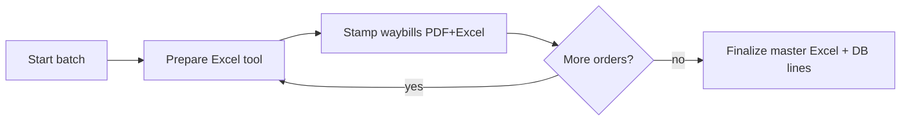

# Implementation Plan: Waybill stamper & Online Orders remake

> **Completed 2026-06-05.** Spec: [[specs/waybill stamper and online orders remake]]

## Summary

Reframe CSR **Online Orders** from three opaque pipelines (Partner / VIP / Shopee SPX) into a **two-phase batch workflow** aligned with product theory (“one process, multiple tools”):

1. **Prepare Excel** — pick a prep tool (VIP arranger, SPX name merge, or use an existing partner-format sheet); output is always one **PYX-compatible Excel** stash token.
2. **Stamp waybills** — one universal step: upload worker **PDF + prepared Excel** → `waybill_stamper_process_uploads()` → parse rows → `online_orders_lines_append()` → stamped PDF download.
3. **Finalize batch** — unchanged: master print Excel + promote lines to `online_order_parcels` for packing/deliveries.

Backend stamp/parse/append logic is **extracted** from `online_orders_run_partner_stamp`, `run_vip_stamp`, and `run_shopee_*` into shared handlers. Legacy pipeline API actions remain as thin wrappers during cutover, then deprecate. SPA replaces `PipelinePicker` + per-pipeline run steps with **Tools picker → Prep panels → Universal stamp step**.

## Constraints (must read)

- [[000_System_Architecture]] — action-based `api/v1/*`, IMS auth + CSRF on writes
- [[003_Fragile_Edges]] — `waybill_stamper_user_can_access()` shared with pdf-to-excel & order remarks; PhpSpreadsheet 2.x coord helpers; Shopee variant resolution; CSR storage roots via `rts_storage_csr_tool_root()`
- [[010_Product_Theory]] — CSR waybill chain must stay end-to-end compatible (PDF → Excel → Stamper)
- UI: [[004_SPA_Design_System]] · [[005_SPA_UX_Patterns]] — `PageLayout`, `FulfillmentPickerCard`, carousels, toasts, `FileZone`

## Current state (baseline)

| Today | Issue vs spec |
|-------|----------------|
| `OnlineOrdersGeneratorPage` → `PipelinePicker` (partner / vip / shopee_spx) | Feels like three separate products |
| Each pipeline embeds prep **and** stamp in one UX | Spec wants **tools first**, **one stamp step** |
| `run_partner` = parse + stamp + append in one API call | Partner-only; not reusable as final step |
| `run_vip_stamp` stamps but lines appended earlier via `lines_append` | Split across phases inside VIP step |
| `run_shopee_resolve` + `run_shopee_stamp` already split | Closest to target; merge into unified stamp after tool prep |
| `/waybill/stamper`, `/pdf-to-excel`, `/order-remarks` redirect to `/waybill/online-orders` | Good — keep single SPA entry |

## Target UX (from spec)

**Prep tools (phase 1 UI):**

| Tool | Replaces | Output |
|------|----------|--------|
| **VIP Excel arranger** | VIP remarks carousel inside `VipRunStep` | iPYX Excel token + resolved rows |
| **SPX name merge** | Shopee packing-list / PDF-name merge inside `ShopeeSpxRunStep` | iPYX Excel token (partner column layout) |
| **Use existing Excel** | Partner iPYX upload only | User supplies Excel; skip tool |

**Stamp step (phase 2 UI):** PDF(s) + prepared Excel token → stamp → append `csr_online_order_lines` → show `StampResultPanel`.

## Impact preview

| Area | Change |
|------|--------|
| **API** | New prep + unified stamp actions on `api/v1/online_orders.php`; optional thin wrappers on `waybill.php` |
| **Includes** | New `includes/online_orders_prep.php` (or extend `online_orders_generator.php`); shared `online_orders_run_unified_stamp()` |
| **DB** | No schema change expected; optional `pipeline` value `unified` on `csr_online_batch_runs` |
| **SPA** | Restructure `OnlineOrdersGeneratorPage` step machine; new tool/stamp components; deprecate `PartnerRunStep` / `VipRunStep` / `ShopeeSpxRunStep` UI paths |
| **Python** | Reuse `waybill-stamper/processor.py` — no change unless item OCR rules expand |

**Before editing shared includes:** run `impact.php` on `waybill_stamper_process_uploads`, `online_orders_lines_append`, `online_orders_parse_ipyx_excel_paths`, `online_orders_build_ipyx_excel_from_rows`.

## API actions

### New (proposed)

| Action | Method | Handler | Purpose |
|--------|--------|---------|---------|
| `tool_vip_prepare` | POST | `api_online_orders_tool_vip_prepare` | Courier Excel → order remarks parse/resolve → iPYX Excel stash token + row preview |
| `tool_spx_prepare` | POST | `api_online_orders_tool_spx_prepare` | Packing-list Excel + PDF name PDFs **or** PDF-only extract path → merged iPYX Excel token |
| `tool_excel_register` | POST | `api_online_orders_tool_excel_register` | Stash user-supplied iPYX Excel; validate parse; return token + row count |
| `run_unified_stamp` | POST | `api_online_orders_run_unified_stamp` | PDF tokens + excel token → stamp + parse + `lines_append` + run record |

### Retained (unchanged behavior during cutover)

| Action | Notes |
|--------|-------|
| `batch_start`, `batch_get`, `batch_cancel`, `batch_finalize` | Batch lifecycle |
| `lines_append` | Used by VIP tool path until unified stamp owns append |
| `packaging_stock` | Shopee variant picker stock hints |
| `spx_import_packing_list` | May be absorbed into `tool_spx_prepare` |
| `batch_download` | Master Excel download |

### Deprecated after SPA cutover (keep wrappers 1 sprint)

| Action | Replacement |
|--------|-------------|
| `run_partner` | `tool_excel_register` + `run_unified_stamp` |
| `run_vip_stamp` | `tool_vip_prepare` + `run_unified_stamp` |
| `run_shopee_resolve` + `run_shopee_stamp` | `tool_spx_prepare` + `run_unified_stamp` |

### Existing waybill API (still used)

| Action | File | Use |
|--------|------|-----|
| `stash` | `api/v1/waybill.php` | Upload PDF/Excel to stash before POST |
| `process` | `api/v1/waybill.php` | Standalone stamp (non-batch); keep for exec debugging only |
| download via `token` | `api/v1/waybill.php` | Stamped PDF download |

### Order remarks / PDF-to-excel (called from prep tools, not separate SPA routes)

| Client | File | Use |
|--------|------|-----|
| `orderRemarksApi.ts` | `api/v1/order_remarks.php` | VIP prep |
| `pdfToExcelApi.ts` | `api/v1/pdf_to_excel.php` | SPX PDF name extract |

## Database tables (no migration planned)

| Table | Role in remake |
|-------|----------------|
| `csr_online_batches` | Active batch per CSR user |
| `csr_online_batch_runs` | One row per tool+stamp cycle; `pipeline` column stores `vip` / `shopee_spx` / `partner` / `unified` |
| `csr_online_order_lines` | Source of truth for master Excel + parcel promotion (`tracking_number`, `items`, `courier`, …) |
| `online_order_parcels` | Created on `batch_finalize` — downstream packing/deliveries |

## Item / quantity rules (spec rule #1)

Introduce or centralize **`online_orders_normalize_items_display(string $raw): string`** in `includes/online_orders_generator.php` (or new `online_orders_items.php`):

- Parse promo shorthand (e.g. `B1T2 350ml` → normalized packer text `3× 350ml …`) before save to `csr_online_order_lines.items`
- Reuse in VIP remarks final text, SPX resolve, and iPYX Excel column D
- **Open question:** full rule table for all shop formats — draft from legacy `orderRemarksParse` + Shopee variant helpers; human sign-off on edge cases in spec

## Implementation steps

### Phase 0 — Spec & plan gate

1. [ ] Human checks open questions in spec (item rules, whether Partner PYX upload skips VIP/SPX tools)
2. [ ] Mark spec **Approval to plan** + this plan `approved_by` before Agent implementation

### Phase 1 — Backend: shared stamp + prep handlers

1. [ ] Add `online_orders_run_unified_stamp($pdo, $userId, $batchId, $pdfTokens, $excelToken, $pipelineTag)`:
   - `waybill_stamper_resolve_stash_tokens`
   - `online_orders_parse_ipyx_excel_paths` → line payloads
   - `online_orders_assert_no_duplicate_tracking`
   - `waybill_stamper_process_uploads`
   - `online_orders_lines_append`
   - `online_orders_run_start` / `online_orders_run_complete`
2. [ ] Add `online_orders_tool_vip_prepare()` — wraps order remarks export + excel stash (extract from `online_orders_run_vip_stamp` + `VipRunStep` logic)
3. [ ] Add `online_orders_tool_spx_prepare()` — wraps `spx_import_packing_list` + PDF name merge + `online_orders_build_ipyx_excel_from_rows`
4. [ ] Add `online_orders_tool_excel_register()` — stash + validate iPYX parse only
5. [ ] Wire new actions in `api/v1/online_orders.php` with existing access + CSRF guards
6. [ ] Refactor `run_partner`, `run_vip_stamp`, `run_shopee_*` to call unified handler internally (compatibility)
7. [ ] Run `impact.php` on touched functions; `php -l` on changed PHP

### Phase 2 — Frontend: two-phase wizard

1. [ ] Replace step machine in `OnlineOrdersGeneratorPage`:
   - `loading` → `start` → `tools` → `stamp` → `stamp_result` → `post_run` → `done`
2. [ ] Add `ToolsPicker.tsx` — three cards: VIP arranger, SPX name merge, Use existing Excel
3. [ ] Add `VipPrepTool.tsx` — move remarks carousel from `VipRunStep` (no stamp UI)
4. [ ] Add `SpxPrepTool.tsx` — move packing-list / PDF extract / variant resolve / review from `ShopeeSpxRunStep` (no stamp UI)
5. [ ] Add `ExcelUploadTool.tsx` — single iPYX Excel stash + row preview
6. [ ] Add `UnifiedStampStep.tsx` — PDF `FileZone` + prepared excel token (from prep state) → `run_unified_stamp`
7. [ ] Extend `onlineOrdersApi.ts` + `onlineOrdersTypes.ts` for new actions
8. [ ] Keep `StampResultPanel`, duplicate-tracking modal, batch finalize flow
9. [ ] Remove or gate old `PipelinePicker`, `PartnerRunStep`, `VipRunStep`, `ShopeeSpxRunStep` behind feature flag until E2E passes

### Phase 3 — Navigation & cleanup

1. [ ] Confirm sidebar: single **Online Orders** entry (`/waybill/online-orders`) — no change expected
2. [ ] Keep legacy redirects (`/waybill/stamper`, `/pdf-to-excel`, `/order-remarks`) → online-orders
3. [ ] Update `010_Product_Theory` CSR bullet: “prep tools + unified stamp” (theory drift fix)
4. [ ] Add fragile-edge note if prep tools bypass duplicate-tracking at wrong stage

### Phase 4 — Close

1. [ ] Manual E2E (see test plan)
2. [ ] `php tools/memory_bank/generate_all.php`
3. [ ] Problem record + [[002_Memory_Bank]] entry
4. [ ] Move plan to `plans/archive/`
5. [ ] Update [[001_System_State]] active spec/plan pointers

## Files to touch (expected)

| File | Action |
|------|--------|
| `_System_Core/specs/waybill stamper and online orders remake.md` | Human approval checkboxes |
| `includes/online_orders_generator.php` | Extract unified stamp; prep helpers; item normalize |
| `includes/shopee_spx_packing_list.php` | Called from `tool_spx_prepare` |
| `includes/order_remarks.php` | Called from `tool_vip_prepare` |
| `includes/waybill_stamper.php` | No signature change; callers only |
| `api/v1/online_orders.php` | New actions + dispatch |
| `app/src/app/pages/csr/OnlineOrdersGeneratorPage.tsx` | New step machine |
| `app/src/app/components/csr/onlineOrders/ToolsPicker.tsx` | **create** |
| `app/src/app/components/csr/onlineOrders/VipPrepTool.tsx` | **create** (from VipRunStep) |
| `app/src/app/components/csr/onlineOrders/SpxPrepTool.tsx` | **create** (from ShopeeSpxRunStep) |
| `app/src/app/components/csr/onlineOrders/ExcelUploadTool.tsx` | **create** |
| `app/src/app/components/csr/onlineOrders/UnifiedStampStep.tsx` | **create** |
| `app/src/app/lib/onlineOrdersApi.ts` | New client methods |
| `app/src/app/lib/onlineOrdersTypes.ts` | Prep + unified stamp types |
| `app/src/app/components/csr/onlineOrders/PipelinePicker.tsx` | **remove** after cutover |
| `app/src/app/components/csr/onlineOrders/PartnerRunStep.tsx` | **remove** after cutover |
| `app/src/app/components/csr/onlineOrders/VipRunStep.tsx` | **remove** after cutover |
| `app/src/app/components/csr/onlineOrders/ShopeeSpxRunStep.tsx` | **remove** after cutover |
| Reuse unchanged | `StampResultPanel`, `DuplicateTrackingModal`, `ShopeeItemsReviewPanel`, `ItemResolverCarousel`, `AmbiguousOrderCarousel`, `FileZone`, `orderRemarksApi.ts`, `pdfToExcelApi.ts`, `waybillApi.ts` |

## UI routes

| Route | Component | Roles | Change |
|-------|-----------|-------|--------|
| `/waybill/online-orders` | `OnlineOrdersGeneratorPage` | executive, csr_tl, csr_staff | **Remake** internal wizard |
| `/waybill/stamper` | redirect → online-orders | — | Keep |
| `/waybill/pdf-to-excel` | redirect → online-orders | — | Keep |
| `/waybill/order-remarks` | redirect → online-orders | — | Keep |
| `/fulfillment/online-parcels` | `OnlineParcelsPage` | CSR + PM | Unchanged (downstream) |

No new routes required.

## Test plan

### Prep tools

- [ ] **VIP:** Upload courier Excel → resolve ambiguous remarks in carousel → download/preview PYX Excel → token stored for stamp step
- [ ] **SPX packing list:** Excel + PDF names → variant picker for honey lines → review full batch → PYX Excel token
- [ ] **SPX PDF-only:** PDF extract → resolve → review → PYX Excel token
- [ ] **Existing Excel:** Upload valid PYX sheet → row count matches parse; invalid sheet shows clear error

### Unified stamp

- [ ] PDF + prepared Excel → stamped PDF download; `batch.line_count` increases
- [ ] Duplicate tracking in batch → 409 + `DuplicateTrackingModal` (same as today)
- [ ] Unmatched waybill rows reported in stamp result meta (matched/total/unmatched)
- [ ] **B1T2 / promo cell** normalizes to expected `items` text in DB (once rule implemented)

### Batch lifecycle

- [ ] Multiple tool→stamp cycles in one batch (VIP run then SPX run) → master Excel merges all lines
- [ ] **Finalize** → master Excel download + parcels in `packing` on Online Parcels
- [ ] **Cancel batch** clears active state
- [ ] CSR staff + CSR TL can run; executive can run; prod_manager forbidden (if still true)

### Regression

- [ ] Packaging stock hints still load in SPX variant picker (`packaging_stock`)
- [ ] Hard refresh after `npm run build`
- [ ] Large PDF upload still respects `waybill_stamper_upload_preflight` limits

### Roles

| Role | Expect |
|------|--------|
| csr_staff | Full prep + stamp + finalize |
| csr_tl | Same |
| executive | Same |
| prod_manager | No access (verify `online_orders_user_can_access`) |

## Risks & mitigations

| Risk | Mitigation |
|------|------------|
| Breaking Shopee variant / review flow | Move `ShopeeSpxRunStep` logic verbatim into `SpxPrepTool`; E2E before deleting old components |
| Duplicate-tracking checked at wrong step | Keep `online_orders_assert_no_duplicate_tracking` in unified stamp (and prep if lines pre-saved) |
| `waybill_stamper_user_can_access` drift | Do not fork access; prep tools use same guard as `online_orders.php` |
| PhpSpreadsheet API regression | Only use `online_orders_coord()` / `getCell` pattern per [[003_Fragile_Edges]] |
| VIP lines appended twice | Unified stamp owns append; remove duplicate append from VIP prep path |
| Users confused during transition | Keep old API wrappers one release; single SPA entry already consolidated |

## Rollback

- Revert SPA to `PipelinePicker` + three run steps (git revert)
- New API actions unused if frontend reverted; old `run_*` actions still work if wrappers kept
- No DB migration to roll back

## Open questions (need human answers before implementation)

1. [ ] **Item shorthand rules** — full list of promo tokens (B1T2, etc.) and expected packer strings?
2. [ ] **Partner seller orders** — is “Use existing Excel” enough, or a dedicated Partner prep tool with iPYX validation messaging?
3. [ ] **VIP stamp today** appends lines in remarks phase — confirm unified stamp should always parse Excel for lines (single append point)?
4. [ ] **Pipeline tag** on runs — keep `partner`/`vip`/`shopee_spx` for analytics or collapse to `unified`?

## Approval

- [ ] Human approved — OK to implement in Agent mode
- Approved date: _
